# Architektur- & Umsetzungsplan: `raspi-ansible` Refactoring (SUP-143)

Dieser Plan fasst alle Entscheidungen aus unserem Design-Interview zusammen und beschreibt den Umbau des Repositories zu einer flexiblen, skalierbaren Ansible-Struktur für bestehende und zukünftige Geräte.

---

## 1. Ziel-Architektur & Verzeichnisstruktur

```mermaid
flowchart TD
    subgraph Playbooks ["playbooks/ (Einstiegspunkte)"]
        P_SITE["site.yml (Gesamt-Setup)"]
        P_BASE["base-setup.yml (Basis-Setup)"]
        P_UPD["update.yml (Alltags-Updates)"]
        P_DRV["drive.yml (Festplatten-Mounts)"]
        P_DOC["docker.yml (Docker Engine)"]
        P_CMP["docker-compose.yml (Compose-Stacks)"]
        P_MON["monitoring.yml (Out-of-Scope / Bestand)"]
    end

    subgraph Roles ["roles/ (Wiederverwendbare Logik)"]
        R_BASE["roles/base<br/>(Pakete, User nico, NOPASSWD-Sudo, SSH-Härtung)"]
        R_DRV["roles/drive<br/>(Multi-Disk fstab-Mounts)"]
        R_DOC["roles/docker<br/>(Debian/Ubuntu, arm64/amd64, Prune-Cron)"]
        R_CMP["roles/docker_compose<br/>(Git, Verzeichnisse, .env, Multi-Compose-Dateien)"]
    end

    subgraph Inventory ["inventory/ & vaults/ (Daten & Secrets)"]
        INV["inventory/hosts.yml"]
        GV["inventory/group_vars/all.yml"]
        HV_RPI["inventory/host_vars/raspberrypi/vars.yml"]
        HV_PAR["inventory/host_vars/parents_pi/vars.yml"]
        HV_VPS["inventory/host_vars/strato_vps/vars.yml"]
        V_DIR["vaults/<br/>(raspberrypi.yml, strato_vps.yml)"]
    end

    P_SITE --> R_BASE & R_DRV & R_DOC & R_CMP
    P_BASE --> R_BASE
    P_DRV --> R_DRV
    P_DOC --> R_DOC
    P_CMP --> R_CMP
    P_UPD -.->|"APT + Compose Pull/Up"| INV
```



### Geplante Dateistruktur

```text
.
├── ansible.cfg                              # Angepasst auf inventory/hosts.yml, remote_user = nico, roles_path = ./roles
├── CLAUDE.md                                # Aktualisierte Dokumentation für KI-Assistenten
├── README.md                                # Aktualisierte Dokumentation & Cheatsheet für den Alltag
├── docs/
│   └── SUP-143 Ansible Repo: mit KI über bisherige Struktur grillen und reviewen.md
├── inventory/
│   ├── hosts.yml                            # Logische Hostnamen + Funktionsgruppen
│   ├── group_vars/
│   │   └── all.yml                          # Globale Defaults (admin_user: nico, admin_ssh_public_keys, base_packages)
│   └── host_vars/
│       ├── raspberrypi/
│       │   └── vars.yml                     # Festplatten-UUID, Compose-Repo, Themen-Liste, Verzeichnisse
│       ├── parents_pi/
│       │   └── vars.yml                     # Platzhalter für die 2 Festplatten-UUIDs & künftige Compose-Stacks
│       └── strato_vps/
│           └── vars.yml                     # VPS-spezifische Settings (z.B. sudo.ws Kompatibilität)
├── vaults/
│   ├── raspberrypi.yml                      # Verschoben aus group_vars/raspberrypi/vault.yml (unverändert verschlüsselt)
│   └── strato_vps.yml                       # Verschoben aus group_vars/strato_vps/vault.yml (unverändert verschlüsselt)
├── roles/
│   ├── base/
│   │   └── tasks/main.yml                   # Basis-Pakete, User-Anlage ('nico'), NOPASSWD-Sudo, SSH-Keys & SSH-Härtung
│   ├── drive/
│   │   └── tasks/main.yml                   # Iteriert über 'host_drives'-Liste für beliebig viele Festplatten pro Host
│   ├── docker/
│   │   └── tasks/main.yml                   # Dynamisch für Debian/Ubuntu & arm64/amd64 + Docker-Gruppe + Prune-Cron
│   └── docker_compose/
│       └── tasks/main.yml                   # Git Clone/Pull, Host-Ordner, .env (optional) & Themen-Compose-Dateien
└── playbooks/
    ├── site.yml                             # Führt alle Rollen entsprechend der Gruppenzugehörigkeit aus
    ├── base-setup.yml                       # Führt 'roles/base' auf allen (oder via --limit gewählten) Hosts aus
    ├── update.yml                           # APT-Upgrade + Docker-Compose Pull/Up + Reboot-Required-Prüfung
    ├── drive.yml                            # Führt 'roles/drive' auf 'drive_hosts' aus
    ├── docker.yml                           # Führt 'roles/docker' auf 'docker_hosts' aus
    ├── docker-compose.yml                   # Führt 'roles/docker_compose' auf 'docker_hosts' aus
    └── monitoring.yml                       # Bleibt vorerst erhalten (Out-of-Scope für diesen Umbau)
```

> [!NOTE]
> Die bisherigen Einzel-Playbooks `playbooks/main.yml` und `playbooks/vps-setup.yml` gehen vollständig in [`playbooks/base-setup.yml`](../playbooks/base-setup.yml) (bzw. [`roles/base/tasks/main.yml`](../roles/base/tasks/main.yml)) und [`playbooks/update.yml`](../playbooks/update.yml) auf und wurden entfernt, um Dopplungen zu vermeiden.

---

## 2. Detailliertes Design der Komponenten

### 2.1 Inventory (`inventory/hosts.yml`), Variablen & Vaults

* **Logische Hostnamen statt nackter IPs**:
  * `raspberrypi`: `ansible_host: 192.168.178.10`
  * `parents_pi`: `ansible_host: 192.168.178.46`
  * `strato_vps`: `ansible_host: 217.154.166.48`
  * *(Ausgeklammert / auskommentiert)*: `homeassistant_pi` (`192.168.0.20`), da Home Assistant OS kein Debian/Ubuntu ist.
* **Funktionsgruppen**:
  * `pis`: `raspberrypi`, `parents_pi`
  * `vps`: `strato_vps`
  * `drive_hosts`: `raspberrypi`, `parents_pi`
  * `docker_hosts`: `raspberrypi`, `parents_pi`, `strato_vps`
  * `monitoring_targets`: `raspberrypi`, `parents_pi` (`strato_vps` wird künftig der Monitoring-Server selbst)
* **Automatisches Laden von Variablen & On-Demand Vaults**:
  * Durch die Ablage unter `inventory/group_vars/` und `inventory/host_vars/<hostname>/` lädt Ansible Klartext-Variablen automatisch passend zum Host.
  * Die verschlüsselten Vault-Dateien liegen unter `vaults/<hostname>.yml` und werden von `roles/docker_compose` bei Bedarf per `include_vars` geladen. Dadurch laufen Alltagsbefehle (`update.yml`, `base-setup.yml`, `drive.yml`, `docker.yml`) komplett **ohne** `--ask-vault-pass`.

### 2.2 Rolle `roles/base` (`playbooks/base-setup.yml`)

Vereinheitlicht das Basis-Setup über alle Geräte (Pis & VPS):

1. **Basis-Pakete installieren**: `sudo`, `htop`, `git`, `curl`, `ca-certificates` (erweiterbar über `base_packages` in [`inventory/group_vars/all.yml`](../inventory/group_vars/all.yml)).
2. **Einheitlicher Admin-User (`nico`)**:
   * Legt den User `{{ admin_user }}` (Default: `nico`) mit `/bin/bash` und Gruppe `sudo` an.
   * Erstellt `/etc/sudoers.d/{{ admin_user }}` mit `{{ admin_user }} ALL=(ALL) NOPASSWD: ALL` (validiert via `visudo -cf %s`).
   * **Vorteil**: Sobald `base-setup.yml` einmalig gelaufen ist, benötigt auch `strato_vps` bei regulären Ansible-Läufen kein Sudo-Passwort (und damit kein `--ask-vault-pass`) mehr!
3. **SSH-Public-Keys & Aussperr-Schutz**:
   * In [`inventory/group_vars/all.yml`](../inventory/group_vars/all.yml) gibt es die Liste `admin_ssh_public_keys: []`, in die du deine Public Keys (aus 1Password) eintragen kannst.
   * Wenn `admin_ssh_public_keys` Einträge enthält, werden diese in `/home/{{ admin_user }}/.ssh/authorized_keys` hinterlegt.
   * **Fallback beim Bootstrapping**: Falls `admin_ssh_public_keys` noch leer ist, prüft die Rolle auf dem Zielgerät, ob der initiale User (`root` oder `pi`) eine `authorized_keys` besitzt, und übernimmt diese für `nico`.
   * **Sicherheits-Gate**: Bevor die SSH-Härtung (`PasswordAuthentication no`, `PermitRootLogin no`) aktiviert wird, prüft ein Task, dass `/home/{{ admin_user }}/.ssh/authorized_keys` existiert und **nicht leer** ist. Andernfalls bricht das Playbook vor der SSH-Härtung ab – ein versehentliches Aussperren ist damit ausgeschlossen.
4. **SSH-Härtung**:
   * Setzt `PermitRootLogin no`, `PasswordAuthentication no`, `PubkeyAuthentication yes` in `/etc/ssh/sshd_config` und `/etc/ssh/sshd_config.d/00-hardening.conf` (mit `sshd -t -f %s` Validierung).

> [!TIP]
> **Bootstrapping / Migration bestehender Pis**:
> Auf Geräten, auf denen `nico` noch nicht existiert (wie aktuell `raspberrypi` oder `parents_pi`), führst du einmalig aus:
> `ansible-playbook playbooks/base-setup.yml --limit raspberrypi -e ansible_user=pi`
> Ab dem zweiten Lauf funktioniert alles direkt ohne Parameter über den Standard-User `nico`.

### 2.3 Rolle `roles/drive` (`playbooks/drive.yml`)

* Liest die Liste `host_drives` aus `inventory/host_vars/<host>/vars.yml`.
* Beispiel für `raspberrypi`:
  ```yaml
  host_drives:
    - path: /mnt/drive
      uuid: "f601b704-44be-4bf4-b5e1-0714e03bcdcb"
      fstype: ext4
      opts: "defaults,nofail"
  ```
* Beispiel für `parents_pi`:
  * Vorbereitete Struktur mit auskommentierten Platzhaltern für die 2 Festplatten (`host_drives: []`), sodass ein Lauf auf `parents_pi` nichts überschreibt, bis du die echten UUIDs einträgst.

### 2.4 Rolle `roles/docker` (`playbooks/docker.yml`)

* **Multi-OS & Multi-Arch fähig**:
  * Erkennt automatisch `ansible_distribution | lower` (`debian` auf Raspberry Pi OS, `ubuntu` auf Strato VPS).
  * Erkennt automatisch die Architektur (`aarch64` -> `arm64`, `x86_64` -> `amd64`, `armv7l` -> `armhf`).
  * Nutzt die moderne GPG-Keyring-Methode (`/etc/apt/keyrings/docker.asc`) statt des veralteten `apt_key`-Moduls.
* Fügt `{{ admin_user }}` (`nico`) zur Gruppe `docker` hinzu und richtet den wöchentlichen `docker system prune -af` Cronjob ein.

### 2.5 Rolle `roles/docker_compose` (`playbooks/docker-compose.yml`)

Unterstützt sowohl deinen aktuellen IST-Stand als auch deine geplante Themen-Struktur (`connectivity`, `media`, `documents`, `monitoring` etc.):

* Konfigurierbar pro Host in `inventory/host_vars/<host>/vars.yml`:
  * `compose_repo_url`: z.B. `https://github.com/NicoGartmann/docker-config.git`
  * `compose_repo_dest`: z.B. `/opt/services`
  * `compose_files`: Liste der Compose-Dateien relativ zu `compose_repo_dest`:
    * Aktuell auf `raspberrypi`: `["docker-compose.yml"]`
    * Künftig beliebig pro Host wählbar, z.B.: `["connectivity/docker-compose.yml", "documents/docker-compose.yml"]`
  * `compose_directories`: Liste von Host-Verzeichnissen, die angelegt werden sollen (auf `raspberrypi` z.B. `/mnt/drive/nas` und `/opt/rclone`).
  * `compose_env_vars`: Key-Value-Liste für `.env` (auf `raspberrypi` gespeist aus `vaults/raspberrypi.yml`).
* Wenn für einen Host (wie aktuell `parents_pi` oder `strato_vps`) `compose_repo_url` noch leer/nicht gesetzt ist, überspringt die Rolle den Host sauber.

### 2.6 Alltags-Playbook `playbooks/update.yml`

Dein zentrales Werkzeug für regelmäßige Wartung über alle (oder einzelne) Geräte:

1. **OS-Updates (alle Ziel-Hosts)**:
   * `apt update_cache=yes`
   * `apt upgrade=dist`
   * `apt autoremove=yes`
2. **Container-Updates (alle Ziel-Hosts in `docker_hosts` mit definiertem `compose_repo_url`)**:
   * Aktualisiert das Git-Repo (`git pull` in `{{ compose_repo_dest }}`).
   * Führt für jede Datei in `compose_files` `docker compose -f <file> pull` und `docker compose -f <file> up -d` aus.
   * *Hinweis*: Da `update.yml` die `.env`-Secrets nicht neu schreiben muss, läuft `ansible-playbook playbooks/update.yml` **komplett ohne `--ask-vault-pass`** durch!
3. **Reboot-Prüfung**:
   * Prüft am Ende auf allen Hosts `/var/run/reboot-required` und gibt eine übersichtliche Meldung aus, welche Geräte einen Neustart benötigen (ohne ungefragt neu zu starten).

---

## 3. Alltags-Befehle nach dem Umbau

| Vorhaben | Befehl |
| :--- | :--- |
| **Alle Geräte updaten (OS + Docker Compose)** | `ansible-playbook playbooks/update.yml` |
| **Nur ein einzelnes Gerät updaten** | `ansible-playbook playbooks/update.yml --limit strato_vps` |
| **Basis-Setup auf allen Geräten anwenden** | `ansible-playbook playbooks/base-setup.yml` |
| **Neues Gerät erstmalig bootstrappen (z.B. Pi mit User `pi`)** | `ansible-playbook playbooks/base-setup.yml --limit raspberrypi -e ansible_user=pi` |
| **Docker Compose inkl. `.env`-Secrets aus Vault ausrollen** | `ansible-playbook playbooks/docker-compose.yml --ask-vault-pass` |
| **Komplettes Setup (Base + Drive + Docker + Compose)** | `ansible-playbook playbooks/site.yml --ask-vault-pass` |
